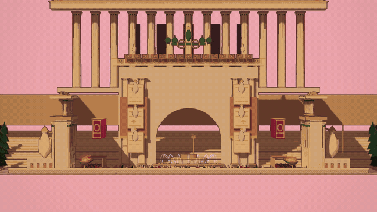
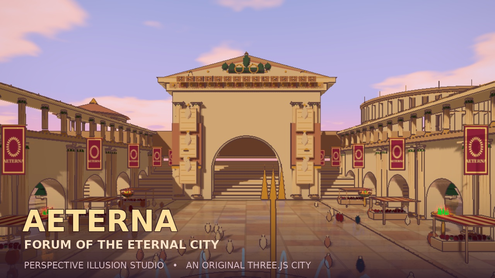
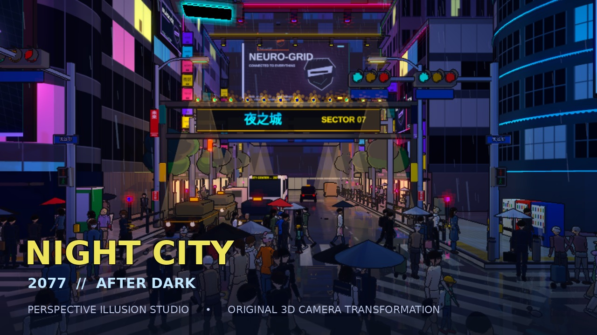

 

<strong>One scene. Two perspectives. An entirely different world.</strong>

  

A reusable filmmaking Skill for transforming apparently flat illustrations into  
layered, explorable Three.js environments — with real geometry and camera motion.

  

<a href="#featured-films">Watch the films</a> &nbsp;·&nbsp;
<a href="#the-illusion">How it works</a> &nbsp;·&nbsp;
<a href="#get-started">Get started</a> &nbsp;·&nbsp;
<a href="SKILL.md">Read the Skill</a> &nbsp;·&nbsp;
<a href="README.zh-CN.md">简体中文</a>

  

---

## Featured films

**The two scenes that best show how this Skill transforms space.** Watch a complete camera move right here, then open the video or explore its editable source.

<table>
<tr>
<td width="50%" valign="top">
  
    
  01 / THE ORIGINAL STUDY · TOKYO
  <h3>SHIBUYA SCRAMBLE</h3>
  
Our first camera experiment. A rain-lit Tokyo crossing transforms from a graphic street tableau into an explorable 3D city.

  
<a href="examples/shibuya-demo.mp4"><strong>▶ Watch film</strong></a> &nbsp;·&nbsp; <a href="explore.html">Explore in 3D</a>

</td>
<td width="50%" valign="top">
  
    
  02 / THE CLASSICAL WORLD · AETERNA
  <h3>THE ETERNAL FORUM</h3>
  
Marble columns, a ceremonial arch and an imaginary imperial city unfold beneath the warm Mediterranean sunset.

  
<a href="scenes/aeterna-forum/aeterna_final.mp4"><strong>▶ Watch film + score</strong></a> &nbsp;·&nbsp; <a href="scenes/aeterna-forum/">Explore source</a>

</td>
</tr>
</table>

  Two genuine 3D render sequences, not zoomed still images. Select either animation to open its full MP4.

 

## Selected worlds

A small collection of three environments, all created with the same camera method. **Tokyo and AETERNA lead the visual story; Night City remains a complete third example.**

<table>
<tr>
<td width="33%" valign="top">
  
   
  URBAN / TOKYO
  
<strong>Shibuya Scramble</strong> Wet neon streets, animated crowds and an interactive free-camera viewer.

  
<a href="examples/shibuya-demo.mp4">MP4</a> · <a href="explore.html">Viewer</a> · <a href="scene.html">Source</a>

</td>
<td width="33%" valign="top">
  
   
  CLASSICAL / AETERNA
  
<strong>The Eternal Forum</strong> An imaginary empire with temples, arches, sculptural fountains and a bespoke score.

  
<a href="scenes/aeterna-forum/aeterna_final.mp4">MP4</a> · <a href="scenes/aeterna-forum/">Source & audio</a>

</td>
<td width="33%" valign="top">
  
   
  FUTURISTIC / NIGHT CITY
  
<strong>Night City 2077</strong> A neon-drenched futuristic variation with hovercars, megatowers and synth music.

  
<a href="scenes/night-city-2077/night_city_2077.mp4">MP4</a> · <a href="scenes/night-city-2077/">Source & audio</a>

</td>
</tr>
</table>

Every film: approximately 10 seconds · 1280 × 720 · 15 native FPS · H.264. These are stylised and fictionalised worlds, not exact historical, geographic or game reconstructions.
---

## The illusion

A perspective illusion is not a zoom applied to a finished image. The world is built in **three dimensions first**. From an extreme telephoto camera, the distance between its objects almost disappears. As the camera dollies and the lens opens, the same geometry reveals its depth.

<table>
<tr>
<td width="33%"></td>
<td width="33%"></td>
<td width="33%"></td>
</tr>
<tr>
<td><strong>01 — Compress</strong> ~2° telephoto. Buildings and people appear layered on one flat plane.</td>
<td><strong>02 — Unfold</strong> 74–84° wide-angle reveal. The camera moves while the focal plane stays anchored.</td>
<td><strong>03 — Reframe</strong> A new oblique angle makes the hidden spatial relationships visible again.</td>
</tr>
</table>

The underlying dolly-zoom relationship is:

`D = (W / 2) / tan(FOV / 2)`

Here `W` is the width at the focus plane, `FOV` is the horizontal field of view, and `D` is the camera-to-focus-plane distance. The Skill keeps this composition controlled while bringing out real parallax. See [camera design](references/camera-design.md).

## Built for repeatable production

<table>
<tr>
<td width="25%" valign="top"><strong>01 / MODEL</strong> Construct architecture, characters, signage and props with editable Three.js geometry.</td>
<td width="25%" valign="top"><strong>02 / DIRECT</strong> Animate telephoto compression, lens expansion and a secondary viewpoint.</td>
<td width="25%" valign="top"><strong>03 / RENDER</strong> Composite geometry, shadows, normals and outlines into illustrated frames.</td>
<td width="25%" valign="top"><strong>04 / VERIFY</strong> Review keyframes, motion continuity, loop joins and output metadata.</td>
</tr>
</table>

The renderer outputs **native 3D frames**, rather than inventing in-between images using optical-flow interpolation. This avoids the large shape distortions we encountered in early experiments, though fine-line shimmer can still appear with limited antialiasing or low native frame rates.

---

## Get started

**Explore an existing city, or build a new illusion.** The source is open and local; you do not need a hosted browser or paid video service.

### Path A — Explore Shibuya on your Mac

[**Download the entire repository as ZIP**](https://github.com/Dreaminmaster/perspective-illusion-studio/archive/refs/heads/main.zip) · [Open interactive viewer source](explore.html)

Extract the folder and double-click **`start-mac.command`**. The launcher checks Node.js, installs dependencies the first time, then opens the interactive Three.js street viewer in your browser.

Controls: drag to orbit · right-drag to pan · scroll to zoom · W/A/S/D to move · Q/E for height · F to replay the cinematic camera · R to reset. Node.js 22+ is required; Chrome is recommended. The local server stops when you close its terminal.

### Path B — Run the Skill and render

~~~bash
git clone https://github.com/Dreaminmaster/perspective-illusion-studio.git
cd perspective-illusion-studio
npm ci
npm test

# Explore the local Three.js scene
npm run explore

# Or render the camera sequence into an MP4
npm run preview
npm run render:crisp
~~~

**Requirements:** Node.js 22+, Chrome/Chromium, FFmpeg and a working WebGL backend. For local Chrome outside Linux, set `CHROME_BIN` to the executable path. High-quality rendering benefits from GPU acceleration. For a step-by-step brief, start with [SKILL.md](SKILL.md).

> **Example brief:** “Use the Perspective Illusion Studio Skill to create a 10-second illustrated Venetian canal. Begin near 2° telephoto, unfold the scene with a true camera dolly zoom, then reveal it from a second angle. Show keyframes before rendering and deliver the editable Three.js project.”

### Source map

| Start here | What it contains |
|:--|:--|
| [`SKILL.md`](SKILL.md) | The reusable filmmaking instructions for a coding assistant |
| [`scene.html`](scene.html), [`render.mjs`](render.mjs) | Shibuya scene and native-frame video renderer |
| [`explore.html`](explore.html) | Interactive local 3D viewer |
| [`scenes/`](scenes/) | Night City and AETERNA, including films, source and audio |
| [`references/`](references/) | Camera design and visual-quality checklist |
| [`scripts/verify-skill.mjs`](scripts/verify-skill.mjs) | Automated repository checks |

<strong>Technical notes & limitations</strong>

- The three bundled films are illustrative demonstrations at **720p, 15 native FPS**, not 4K or 60 FPS.
- Real 3D frames reduce interpolation warping; they do not guarantee flicker-free fine lines.
- The Shibuya viewer is interactive. The other two scenes are provided as editable Three.js projects rather than ready-made free-roam apps.
- The Skill is a set of instructions and files for compatible coding agents; this repository does **not** automatically install a permanent ChatGPT capability.
- Fictionalised urban settings and cyberpunk motifs are independent visual interpretations; no official game assets are claimed.

---

## Origin & credits

**The foundation:** [Simcraft / perspective-illusion](https://github.com/dotslashsimran/simcraft/tree/main/skills/video/perspective-illusion), by **Simran Sachdeva** (© 2026, MIT). Its Three.js template, camera method and multipass rendering utilities form the upstream basis for this project.

**The adaptation:** [Dreaminmaster](https://github.com/Dreaminmaster), working collaboratively with ChatGPT, developed the Shibuya demonstration and refined the lens choreography, clarity-oriented rendering workflow, reusable Skill documentation and additional scene experiments.

Original attribution and licence are preserved in [LICENSE](LICENSE) and [CREDITS.md](CREDITS.md).

THREE WORLDS. ONE CAMERA LANGUAGE.

