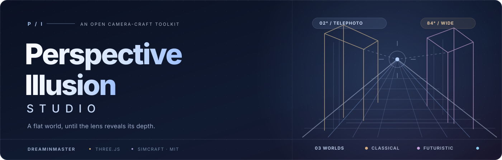
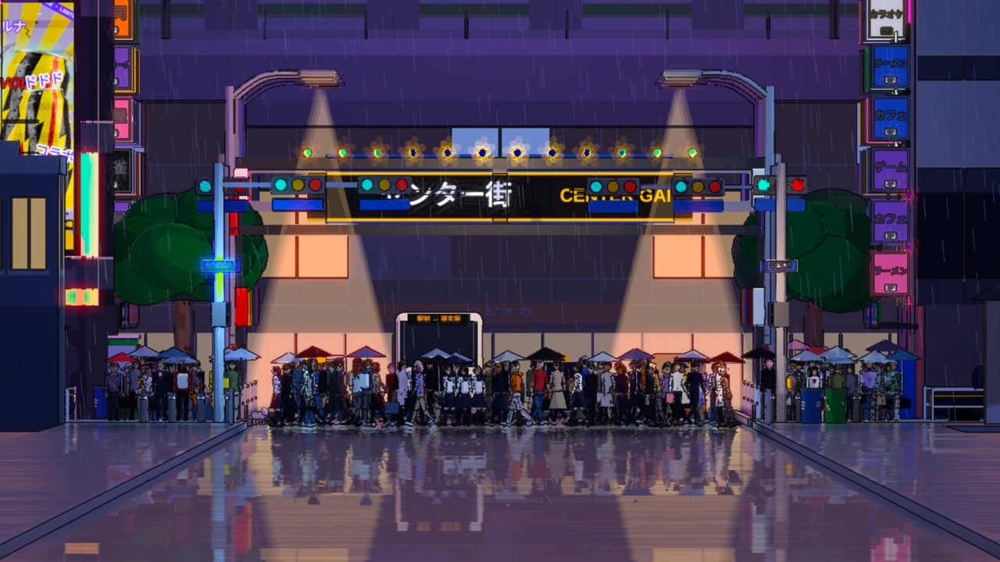
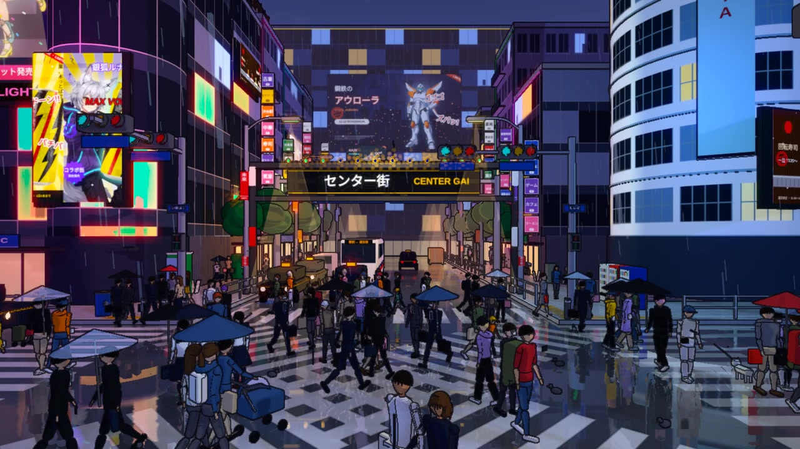
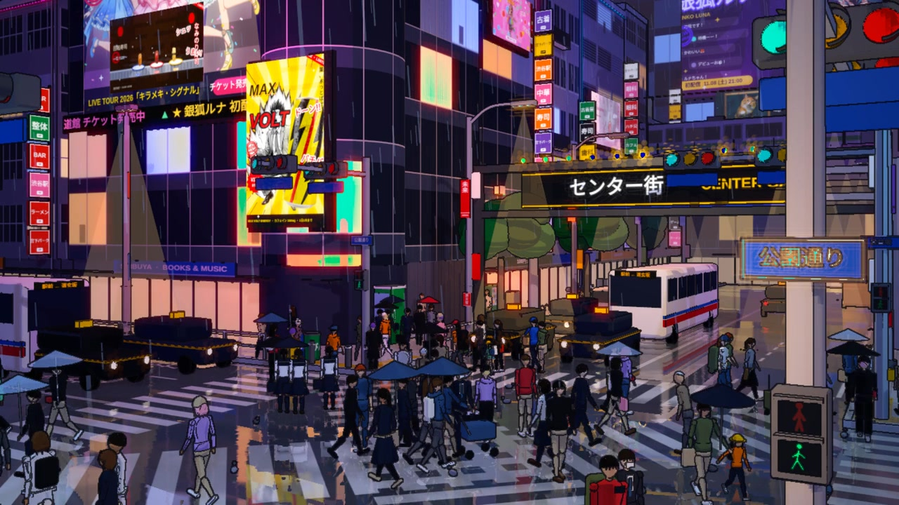
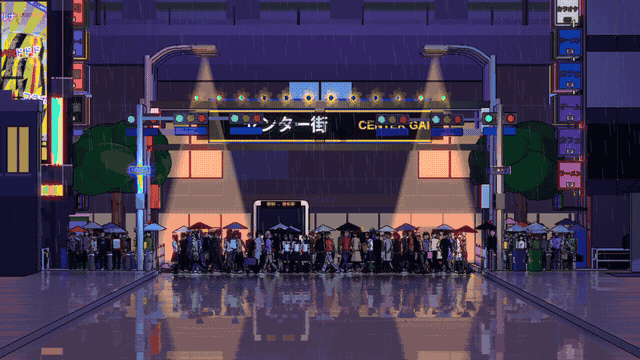

  

  

**Cinematic optical illusions. Built from real, editable 3D.**

An open filmmaking Skill developed through a collaborative Tokyo Shibuya project.

 

[**Explore the demo**](#-tokyo--shibuya-scramble) &nbsp;·&nbsp;
[**Read the Skill**](SKILL.md) &nbsp;·&nbsp;
[**Quick start**](#-quick-start) &nbsp;·&nbsp;
[**简体中文**](README.zh-CN.md)

 

## A flat illustration. Until the camera moves.

What looks like a single, intricately drawn city is actually a complete **Three.js environment**. An extremely long lens visually compresses distant buildings, signs and pedestrians. Then the camera moves closer while its field of view opens — suddenly, every layer separates into real perspective.

No replacement background. No sequence of AI-generated intermediate images. The reveal comes from a **physical camera transform applied to actual 3D geometry**.

<table>
<thead><tr>
<th width="33%" align="center">01 · COMPRESS</th>
<th width="33%" align="center">02 · UNFOLD</th>
<th width="33%" align="center">03 · REVEAL AGAIN</th>
</tr></thead>
<tbody>
<tr>
<td></td>
<td></td>
<td></td>
</tr>
<tr>
<td align="center">2° long lens · compressed city</td>
<td align="center">78–84° dolly zoom · deep perspective</td>
<td align="center">30° yaw · secondary 3° → 58° reveal</td>
</tr>
</tbody>
</table>

## 🎬 Tokyo — Shibuya Scramble

 

Illustrated rain-soaked crossing · luminous signs · pedestrians · shifting lens compression

  

### [▶ Watch the complete Shibuya MP4](examples/shibuya-demo.mp4)

Click the animated preview to open the video, or download the MP4 from GitHub.

 

| | **Verified demo specifications** |
|:--|:--|
| **Scene** | Tokyo Shibuya-inspired crossing, stylized rather than geospatially exact |
| **Runtime** | 10 seconds, seamless-intent camera sequence |
| **Native render** | **1280 × 720** · **15 FPS** · H.264 |
| **Perspective** | 2° → 78°/84° frontal dolly zoom, plus oblique 3° → 58° reveal |
| **Engine** | Three.js with geometry, moving crowds, signage, rain and compositing |
| **Frame generation** | Real 3D renders; **no optical-flow interpolation** |
| **Known limitation** | Fine-line shimmer remains in some shots; higher native FPS and AA need more GPU time |

> [!NOTE]
> This scene is an **artistic interpretation of Shibuya**, not a survey-accurate digital replica of the intersection. Advertisements and illustrated characters are fictional.

## What we improved

The [original Simcraft perspective-illusion technique](https://github.com/dotslashsimran/simcraft/tree/main/skills/video/perspective-illusion) provides the crucial camera model, Four-Pass illustration renderer, scene templates and loopable movement. This edition documents the additional changes developed through a hands-on Shibuya video iteration.

| Core technique | Collaborative refinement |
|:--|:--|
| Telephoto flattening | Strengthened the initial compression to **2°** |
| Camera dolly zoom | Rebuilt keyframes around **78°/84°**, making depth emergence obvious |
| Corner views | Introduced a visually distinct **30° oblique** second reveal |
| Illustrated night rendering | Reduced excessive haze, rain and bloom to retain architectural edges |
| Quality / export process | Removed optical-flow frame interpolation responsible for warped and blurry transitions |
| Repeatable skills | Added a portable **SKILL.md**, camera study, quality checks and a runnable demo project |

### The camera, in one equation

The focal plane stays approximately the same size within the composition while camera distance changes with lens angle:

`D = (W / 2) / tan(FOV / 2)`

Here `W` is the visible width at the focus plane. As the FOV widens and the camera approaches, hidden distance between near and far objects becomes legible. For the actual timeline, see [camera design](references/camera-design.md).

## ⚡ Quick start

**Requirements:** Node.js 22+, FFmpeg, Chrome/Chromium and WebGL. Hardware graphics acceleration is recommended for high-quality rendering.

~~~bash
git clone https://github.com/Dreaminmaster/perspective-illusion-studio.git
cd perspective-illusion-studio
npm ci
npm test

# Generate a quick preview
npm run preview

# Render clearer, native scene frames
npm run render:crisp
~~~

The renderer defaults to `/usr/bin/google-chrome` on Linux. Set `CHROME_BIN` to your Chrome executable path on macOS or Windows. Rendering on a software-only GPU is possible but much slower.

## Use it as an AI Skill

Open **[SKILL.md](SKILL.md)** and supply it to a coding assistant that supports skills or repository instructions. The skill captures the steps for building a scene that fools the eye, designing a dramatic lens reveal, inspecting its keyframes, rendering from actual 3D frames and checking the result.

**Example creative brief**

> Make a 10-second perspective illusion of a Kyoto station platform. Begin with a compressed 2° long-lens shot that resembles a flat illustration. Dolly forward into a wide 3D view, then reveal the platform again from an oblique angle. Preserve all editable Three.js source and present keyframe stills before final rendering.

The repository is a **reusable Skill source package**. It does not automatically install itself as a permanent ChatGPT capability.

<strong>Project structure · click to expand</strong>

~~~text
perspective-illusion-studio/
├── SKILL.md                     Full reusable AI filmmaking workflow
├── scene.html                   Editable Tokyo / Shibuya 3D scene
├── render.mjs                   Native-frame clear renderer
├── render_fast.mjs              Sampled renderer based on Simcraft
├── cutouts/                     12 original source illustration assets
├── examples/
│   ├── shibuya-demo.mp4          Complete 10-second MP4
│   └── shibuya-keyframes.jpg    Camera-study storyboard
├── assets/
│   ├── hero.svg                  Project cover art
│   ├── shibuya-loop.gif          Animated README preview
│   └── stills/                   Flat / wide / oblique frames
├── references/
│   ├── camera-design.md          Lens choreography and rationale
│   └── quality-checks.md         Render and visual QA
├── scripts/                     Reusable verification scripts
├── README.zh-CN.md              Chinese introduction
├── CREDITS.md                   Origin and contributor credits
└── LICENSE                      MIT license
~~~

## Provenance & thanks

Built on **[Simcraft · Perspective Illusion](https://github.com/dotslashsimran/simcraft/tree/main/skills/video/perspective-illusion)**, created by **Simran Sachdeva** (© 2026, MIT). The original license and copyright notice are preserved for reused source code and cut-out assets.

The Shibuya adaptation and iterative camera / rendering improvements were developed by **[Dreaminmaster](https://github.com/Dreaminmaster) in collaboration with ChatGPT**. See [CREDITS.md](CREDITS.md). This project does not claim authorship over the original Simcraft technique.

---

<em>Made to reveal what perspective hides.</em>

