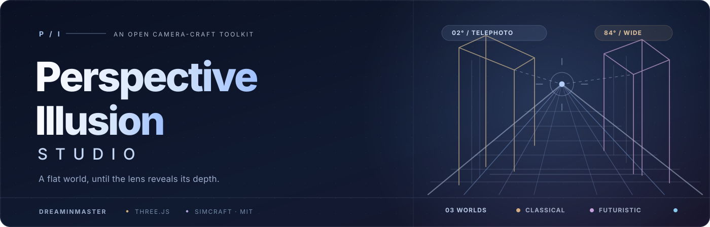
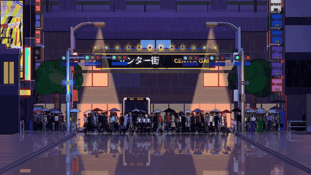
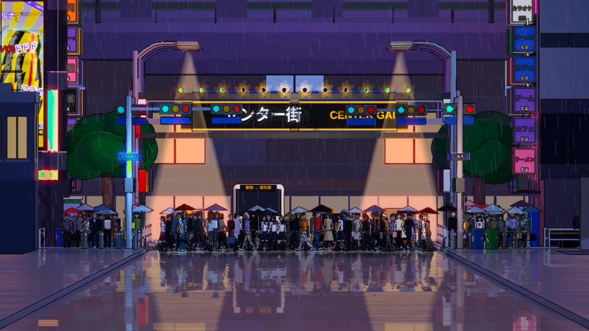
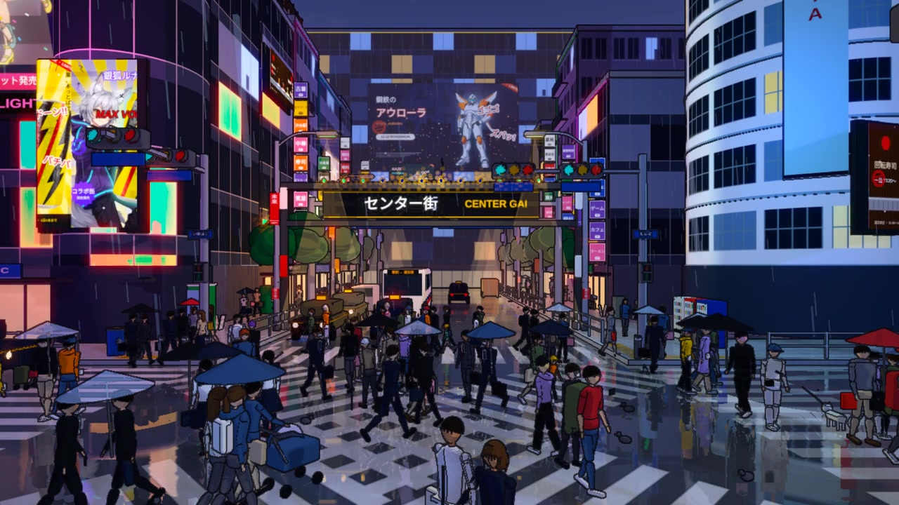
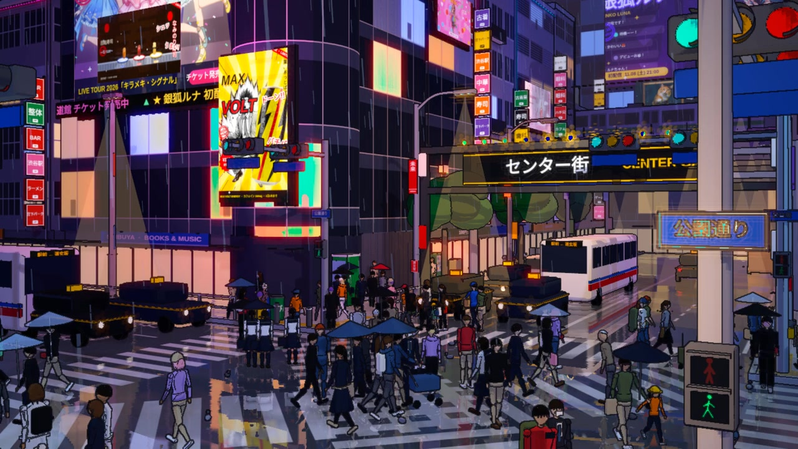
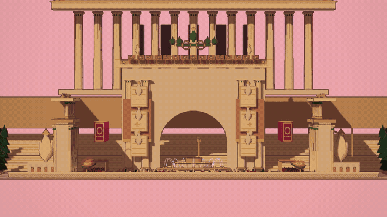
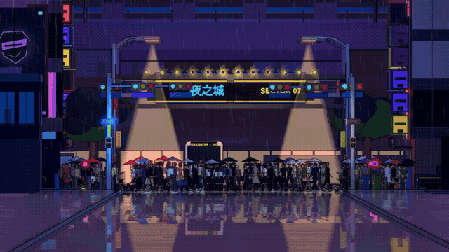

  

**让一张平面的城市插画，在镜头移动中展开真正的三维空间。**

 

[**▶ 观看东京涩谷成品**](examples/shibuya-demo.mp4) &nbsp;·&nbsp;
[**技能说明 SKILL.md**](SKILL.md) &nbsp;·&nbsp;
[**English README**](README.md)

 

# Perspective Illusion Studio · 透视错觉工作室

这是一套可以实际运行、修改并重复使用的 **Three.js 透视错觉视频制作技能**。

利用远距离超长焦镜头，把不同深度的街道、建筑和行人视觉上压缩成一张平面插画；随后镜头向前移动、视角逐渐扩大，原先隐藏的纵深就会突然显现。**画面变化来自真正的三维相机运动，而不是 AI 图片切换。**

## 🎬 最新作品 · 东京涩谷十字路口

 

**[▶ 点击观看 / 下载完整的 10 秒 MP4](examples/shibuya-demo.mp4)**

Three.js 原生三维渲染 · 非运动插帧 · 日系雨夜商业街

 

<table>
<thead><tr><th width="33%">01 · 长焦压缩</th><th width="33%">02 · 广角展开</th><th width="33%">03 · 侧面透视</th></tr></thead>
<tbody><tr>
<td></td>
<td></td>
<td></td>
</tr><tr>
<td>2° 超长焦，空间看起来几乎是平面的</td>
<td>78°–84° 广角，街道纵深逐渐显现</td>
<td>侧向约 30°，再完成第二次透视展开</td>
</tr></tbody>
</table>

## 🏛️ 最新作品 · AETERNA 永恒帝国广场

一个完全虚构的希腊—罗马帝国古典广场：凯旋门、神庙、圆形圣殿、柱廊、竞技场、海神喷泉、集市和雕像全部由 Three.js 三维几何体构成。黄昏的粉紫色天空与金色大理石共同营造古典幻想城市的氛围。

 

**[▶ 播放 AETERNA 完整有声 MP4](scenes/aeterna-forum/aeterna_final.mp4)**

[**查看全部可编辑三维源代码**](scenes/aeterna-forum/) · [**打开项目说明**](scenes/aeterna-forum/README.zh-CN.md) · [**查看四个关键镜头**](scenes/aeterna-forum/storyboard.jpg)

10 秒 · 1280 × 720 · 15 FPS 原生三维渲染 · 2° 长焦 → 84° 广角 → 26° 侧面展开

本片使用我们的 Perspective Illusion Studio Skill，画面变换来自真正的三维镜头运动，而不是使用参考图制作缩放视频；配乐亦为原创合成的竖琴、长笛、弦乐及喷泉氛围音。

**风格说明：** 当前效果属于风格化的三维插画，和用户提供的高写实参考图并非同一种画质。细小装饰线条可能有轻微闪烁。

## 🌃 新作品 · Night City 2077

 

**[▶ 播放含原创电子配乐的完整 MP4](scenes/night-city-2077/night_city_2077.mp4)**

[**查看全部可编辑三维源码**](scenes/night-city-2077/) · [**查看镜头说明**](scenes/night-city-2077/README.md)

10 秒 · 1280 × 720 · 15 FPS 原生渲染 · 2° → 84° 透视展开

以《赛博朋克 2077》的霓虹反乌托邦氛围为灵感，在原版 Skill 的真实 Three.js 场景中加入了大型未来高楼、全息广告、空中轨道、悬浮出租车、雨夜反射和原创电子配乐。

这是一段**原创的赛博朋克主题三维短片**，不是游戏实机录像或游戏官方素材。它不依赖运动插帧，局部细线闪烁仍可能存在。视频、音轨、源代码和 12 张场景素材都已经放进仓库。

## 这次我们改进了什么？

| 重点 | 共同改进 |
| :-- | :-- |
| **更强的视觉错觉** | 把正面镜头调整为 **2° → 78°/84°**，让远景和近景的差异更明显 |
| **第二次透视展开** | 加入约 **30°** 的侧向镜头，由 **3° → 58°** 展开 |
| **减少模糊** | 去掉容易让人、广告屏和建筑边缘变形的运动插帧 |
| **细节与画质** | 降低过强的雨丝和发光效果，保留真实三维的灯光、行人和建筑层次 |
| **可复用制作流程** | 把镜头、素材、渲染和检查规则整理成独立的 **SKILL.md** |

**成品实际规格：** 1280 × 720、15 FPS、H.264、10 秒。每一帧由真实三维场景渲染；细线仍可能存在轻微闪烁。更高的原生帧率和抗锯齿质量需要较强的 GPU 重新渲染。

> **场景说明：** 这是以涩谷十字路口为灵感的艺术化场景，并不是对真实建筑位置的精确复原。

## 🧭 在 Mac 上自由探索涩谷三维街区

现在除了观看视频，还可以**亲自控制摄像机探索我们建立的东京三维场景**。建筑、斑马线、广告招牌、行人、车辆和雨夜材质都来自同一套 Three.js 模型。

### 一键下载与启动

**[⬇ 下载完整项目 ZIP（GitHub，永久仓库地址）](https://github.com/Dreaminmaster/perspective-illusion-studio/archive/refs/heads/main.zip)**

1. 下载完整 ZIP，解压成文件夹（不要只下载单独的 `explore.html`）。
2. 打开文件夹，**双击 `start-mac.command`**。如果 macOS 阻止打开，请右键单击该脚本并选择“打开”。
3. 第一次启动会检查 Node.js、自动安装项目依赖，然后自动打开网页。
4. 浏览器地址为：`http://127.0.0.1:8765/explore.html?scale=.40`。建议使用 Chrome。
5. 结束时关闭启动脚本的终端窗口，或按 Ctrl+C 停止本地服务器。

**操作方式**

| 操作 | 功能 |
|:--|:--|
| 鼠标左键拖动 | 自由旋转视角 |
| 鼠标右键拖动 | 平移观察中心 |
| 鼠标滚轮 / 触控板缩放 | 靠近或远离物体 |
| **W A S D** | 前后左右移动 |
| **Q / E** | 降低 / 升高镜头 |
| **Shift** | 加速移动 |
| **F** 或“播放透视镜头” | 自动播放原来的长焦到广角错觉 |
| **R** | 重置视角 |
| **P** | 暂停 / 继续行人动画 |
| **保存截图** | 下载当前画面 PNG |

**终端启动备选方案：**

~~~bash
git clone https://github.com/Dreaminmaster/perspective-illusion-studio.git
cd perspective-illusion-studio
npm ci
npm run explore
~~~

然后访问 `http://127.0.0.1:8765/explore.html?scale=.40`。

**注意：** 请先安装 [Node.js 22+](https://nodejs.org/en/download)。首次安装依赖需要联网，之后网页服务器只在本机运行。若画面比较卡顿，可以把网址里的 `scale=.40` 改成 `scale=.30`，减少实时渲染开销。

这是可以旋转和探索的 Three.js 场景，但并非真实涩谷广场的精确建筑测绘模型，也不需要另外安装 Blender。

## ⚡ 开始使用

**环境要求：** Node.js 22+、Google Chrome / Chromium、FFmpeg 和 WebGL。建议在具备硬件图形加速的电脑上制作最终版本。

~~~bash
git clone https://github.com/Dreaminmaster/perspective-illusion-studio.git
cd perspective-illusion-studio

npm ci
npm test
npm run preview

# 采用更清晰的原生三维采样渲染
npm run render:crisp
~~~

建议先阅读 **[SKILL.md](SKILL.md)**，再配合 [镜头设计与调整依据](references/camera-design.md) 和 [画质检查流程](references/quality-checks.md) 开始制作。

### 一个新的使用示例

> 阅读此仓库的 SKILL.md，把涩谷场景替换成京都车站。开头用超长焦把站台和列车压缩成平面插画，再通过真实的镜头移动展开三维空间。先输出长焦、广角、侧向三个关键画面，检查后再生成完整循环视频。

这是一套**可供 AI 编程助手读取的技能源码工程**；单纯收藏或导入仓库，不代表它已经永久安装到 ChatGPT 内部。

## 原作者与许可

本项目基于 **[Simcraft · perspective-illusion](https://github.com/dotslashsimran/simcraft/tree/main/skills/video/perspective-illusion)** 开发，原作者 **Simran Sachdeva**，采用 MIT 许可证。

由 **[Dreaminmaster](https://github.com/Dreaminmaster) 与 ChatGPT** 在涩谷示例中共同改进了镜头设计、画面清晰度和交付流程。我们保留原项目的作者署名与许可信息，详情见 [CREDITS.md](CREDITS.md)。

---

让透视，揭开空间的另一面。

